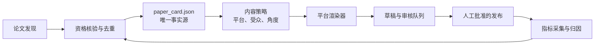

# 统一内容运营系统：现状、目标与迁移路线

## 状态

**状态：拟实施设计。** 本文不授权自动公开发布，也不改变现有 `draft_only` 行为。

## 1. 决策摘要

项目应从“论文到小红书私密草稿”的可靠交付链，演进为以
`paper_card.json` 为唯一事实源的多平台内容运营系统。各平台只能渲染
该事实源，不能从另一平台的文案复制、缩写或再加工。

近期优先级如下：

1. 固化完整的 `paper_card.json` 合同和审核队列。
2. 收敛小红书为唯一支持的草稿交付平台，默认使用“论文快报”。
3. 补齐发现、反馈导入和时间选择的实际执行器。
4. 在有稳定审核与回执后，逐步增加 Notion/GitHub Pages、公众号草稿和知乎候选包。
5. 公开发布始终是独立、人工批准的操作；定时任务不得绕过审批。

## 2. 代码事实与需要纠正的预期

| 能力 | 已有事实 | 尚缺部分 |
| --- | --- | --- |
| 每日运行 | 外部 Codex `redbook-daily-paper-draft` 自动任务是当前文档指定的定时入口。`daily_draft.yaml` 声明 `08:00`。 | 仓库内没有读取该配置并持续运行的调度器。 |
| 候选发现 | `ConferenceAnnouncementSource`、`ProceedingsSource`、`OpenReviewSource` 和 JSONL 去重可用。 | 没有实现 arXiv 发现适配器，也没有把公司、高校、领域配置接入候选过滤。 |
| 论文交付 | 本地 PDF、MinerU、高清图、官方 GitHub、草稿回执等门槛已存在。 | 机构归属、venue、官方仓库核验还没有独立的可回放验证器。 |
| 小红书草稿 | `save-xhs-draft` 是唯一支持入口；CDP 可验证 PDF 文件名。 | 必须收敛为同一编辑器中的“真实话题实体 → PDF → 最后暂存”流程，不能依赖正文普通 `#` 标签。 |
| 发布时段 | `PublishScheduler` 有均衡探索、UCB 和事件触发逻辑。 | 没有实际执行器、没有自动指标抓取，也没有配置统一。 |
| 多平台 | `PublicationPackage` 与 `FilePublisher` 可写本地审核包。 | 没有真实 Notion、公众号、知乎、博客、X、即刻适配器。 |

特别说明：项目中不存在名为 `one-click-draft` 的受支持命令；当前唯一小红书交付命令是：

```powershell
python -m redbook.cli save-xhs-draft ...
```

`redbook/scripts/publish*.py`、直接 API 发布器和一次性 CDP 脚本均为历史/诊断资产，不得由新的定时任务调用。

## 3. 目标架构



### 3.1 `paper_card.json` 合同

每一篇论文只有一个卡片，存放在：

```text
data/workflow_state/<paper_id>/paper_card.json
```

最小结构：

```json
{
  "schema_version": 1,
  "paper_id": "arxiv:2601.21468",
  "identity": {
    "title": "...",
    "authors": [],
    "organizations": [],
    "venue": {"name": "", "year": 0, "status": "preprint"}
  },
  "provenance": {
    "source_records": [],
    "verified_at": "",
    "verifier": ""
  },
  "links": {
    "landing": "",
    "pdf": "",
    "official_github": ""
  },
  "evidence": {
    "problem": [],
    "contributions": [],
    "method": [],
    "benchmarks": [],
    "experimental_conditions": [],
    "results": [],
    "limitations": []
  },
  "assets": {
    "local_pdf": "",
    "mineru_markdown": "",
    "figures": []
  },
  "eligibility": {
    "official_github_verified": false,
    "venue_verified": false,
    "mineru_verified": false,
    "high_resolution_figure_count": 0,
    "eligible": false,
    "reasons": []
  }
}
```

规则：每个事实、数字、图和链接均须能追溯至 `provenance`、解析 Markdown
或官方链接。平台渲染器只读卡片，不读取其他平台文案。

### 3.2 内容策略合同

一篇论文、一个平台、一次草稿只能选择一个角度：

| 角度 | 受众 | 结构重点 |
| --- | --- | --- |
| `research_evidence` | 研究者 | 任务、对照、指标、局限 |
| `implementation` | 工程师 | 复现条件、官方代码、成本与缺口 |
| `industry` | 产品/行业 | 问题价值、适用场景、未验证边界 |
| `learning` | 学习者 | 方法拆解、阅读路径、回看图表的问题 |

小红书日更默认 `research_evidence`，即 `xiaohongshu-paper-brief` 的论文快报规范。
六个 persona 只作为显式策略选择，不对同一论文并行自动生成竞争版本。

## 4. 小红书的唯一生产链

```text
paper_card 资格通过
  -> xiaohongshu-paper-brief / 已选 persona 渲染 JSON
  -> 高分辨率图片、真实话题实体、PDF 均在同一编辑器准备
  -> 校验图片数、实体话题、可见 PDF 文件名
  -> 最后执行“暂存离开”
  -> 写 delivery_receipt.json 和审核队列记录
```

硬规则：

1. 不使用 `--allow-plain-topic-hashtags` 作为自动化降级路径。
2. 真实话题实体、PDF 附件或图片门槛失败时，清理本轮新草稿并写失败状态。
3. 不通过草稿箱标题重新打开编辑器上传 PDF；必须在同一编辑器会话完成附件后再暂存。
4. `publish` 只能由独立的审批操作调用，不能由发现、制稿、重试或定时任务调用。

## 5. 持续运行任务设计

### 5.1 三个独立任务

| 任务 | 建议频率 | 可写入范围 | 不得执行 |
| --- | --- | --- | --- |
| `discover_candidates` | 每 3 小时 | `data/inbox`、source state、候选队列 | 制稿、草稿、发布 |
| `prepare_drafts` | 每日 06:00 | `paper_card`、本地 PDF/解析/图片、平台草稿 | 公开发布 |
| `collect_feedback` | 每日及 2h/24h/7d/30d 到期窗口 | 原始 JSONL、SQLite 指标 | 点赞、评论、关注、修改已发内容 |

候选发现优先顺序：官方会议/Proceedings、OpenReview、arXiv、机构官方页面；
社交媒体只作为线索，必须由前述来源复核。

### 5.2 时段选择

统一以 `daily_draft.yaml` 为运营策略源，并将 `automation.yaml` 中的值降为算法默认值。初始策略：

- 每天最多 1 条公开内容。
- 候选时段为 `08:15`、`12:20`、`20:35`。
- 前 28 条按时段均衡探索，每个时段至少 7 条。
- 之后使用 `PublishScheduler` 的 7 日质量分进行 UCB 选择，保持 30% 探索率。
- 高价值突发论文最多增加一条，要求已核验、发现于 24 小时内，并与当日上一条间隔至少 6 小时。

发布时段决策只选择“何时进入人工批准待发布”，不构成自动公开发布授权。

### 5.3 审核队列状态机

```text
discovered
  -> qualified
  -> evidence_ready
  -> draft_ready
  -> staged
  -> approved | rejected | needs_correction
  -> published
  -> observed_2h -> observed_24h -> observed_7d -> observed_30d
```

`approved` 必须记录审批人、审批时间、内容哈希和平台草稿 ID。任何内容、图片、话题或 PDF 改变都使原批准失效。

## 6. 多平台路线

所有平台遵循 `validate → stage → receipt`，不把 `stage` 和 `publish` 混为一个命令。

| 优先级 | 平台 | 第一阶段能力 | 公开发布策略 |
| --- | --- | --- | --- |
| P0 | Notion / GitHub Pages | canonical 页面或 Markdown 归档 | 工作区/仓库的独立发布设置控制 |
| P0 | 微信公众号 | 仅创建图文草稿 | 人工发布 |
| P1 | 知乎 | 问题匹配后的回答候选或草稿 | 人工选择问题并发布 |
| P1 | X / 即刻 | 短内容草稿 | 人工审核后发布 |
| P2 | B 站 | 选题包、分镜和视频脚本 | 不自动发布 |

## 7. 反馈闭环

保留 `FeedbackStore` 和 `PublishScheduler`，但只有补齐数据采集后才启用策略调优：

1. 从创作中心/允许的 OpenCLI 只读命令导入发布记录和指标；失败时允许人工导入导出数据。
2. 在 2h、24h、7d、30d 记录不可变原始快照，并写入规范化 SQLite 表。
3. 使用收藏率、互动率、深度讨论率、关注转化率计算 7 日质量分。
4. 样本少于 28 条时只探索和报告，不改变选题或文案权重。
5. 只影响未来候选优先级、内容角度、图片类型和时段；不自动修改或删除已发布内容。

## 8. 迁移计划与验收

### 阶段 A：收敛与建模

- 新增 `paper_card` 生成与 JSON Schema 校验。
- 禁止新任务调用 `redbook/scripts/publish*.py` 和 `cdp_*.py`。
- 将 plain hashtag 回退标记为人工诊断模式。
- 统一每日发布上限为 1 条。

**验收：** 同一论文仅有一个事实卡；任何平台草稿可追溯到卡片与内容哈希。

### 阶段 B：可运行日更草稿

- 实现 arXiv、会议官网、OpenReview 的实际发现任务和机构/领域过滤。
- 实现候选去重、资格审核队列和幂等锁。
- 将小红书真实话题、PDF、暂存合并为同页事务，并保留失败清理。

**验收：** 连续 14 天日更只创建完整私密草稿；不重复处理论文；任一硬门槛失败均无残留草稿。

### 阶段 C：观察与时段优化

- 实现发布记录导入、到期窗口采集、周报和时段选择。
- 连续采样 28 条后才启用 UCB 时段建议。

**验收：** 每项时段建议均可追溯到原始指标快照；无指标时回退均衡探索。

### 阶段 D：多平台草稿

- 按 P0/P1 次序实现适配器。
- 每个平台完成不少于 10 个草稿回执和人工审阅后，再讨论是否允许自动 stage。

**验收：** 平台故障不会影响小红书草稿，也不会触发任何其他平台的公开发布。

## 9. 非目标

- 不接入非官方第三方发布 API。
- 不做刷量、自动互动、批量关注或自动评论。
- 不把网络经验当作固定最佳发布时间。
- 不允许定时任务直接公开发布，除非另有明确、可审计的授权与批准记录。
